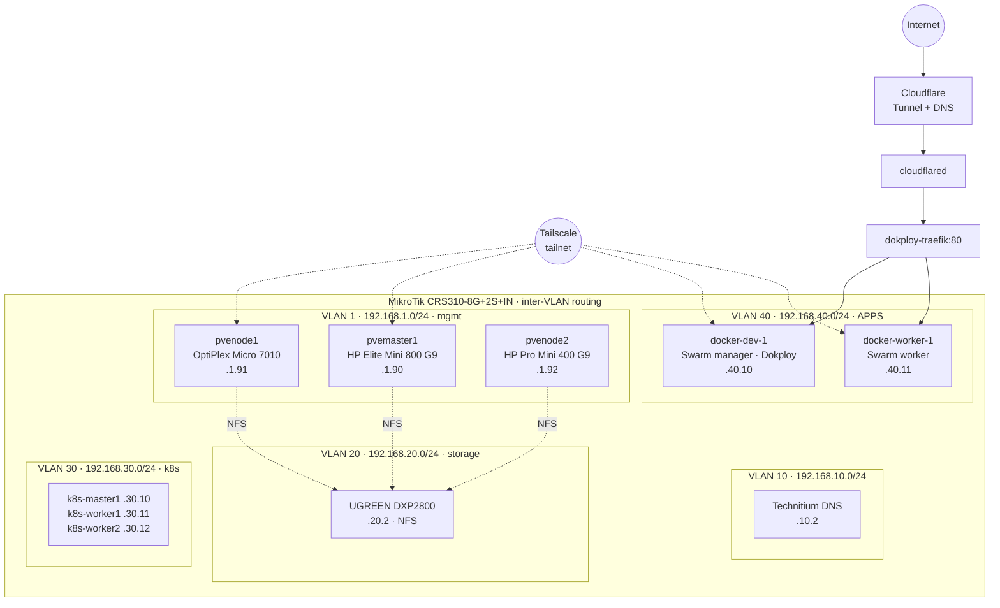

# capilabs homelab

Documentation for the homelab: Proxmox cluster, Kubernetes, Dokploy/Docker Swarm, NAS, and networking.

> **Rule:** no secrets in this repo. Reference the Infisical path instead (e.g. `infisical:/homelab/forgejo/db-password`).
> **Rule:** a change isn't done until the relevant page here is updated.

## Topology

## Map of this repo

| Path | What's there |
|---|---|
| [inventory/hardware.md](inventory/hardware.md) | Physical devices, specs, switch ports |
| [inventory/ip-plan.md](inventory/ip-plan.md) | VLANs and every static IP |
| [network/](network/README.md) | MikroTik, VLANs, Tailscale, Cloudflare Tunnel, DNS |
| [platforms/proxmox.md](platforms/proxmox.md) | Cluster, quorum, storage, NICs |
| [platforms/kubernetes.md](platforms/kubernetes.md) | kubeadm cluster, MetalLB, ingress, Headlamp |
| [platforms/dokploy-swarm.md](platforms/dokploy-swarm.md) | Swarm nodes + **compose conventions** |
| [services/](services/README.md) | Service catalog |
| [gotchas.md](gotchas.md) | Hard-won lessons — read before debugging |
| [open-items.md](open-items.md) | Unresolved problems and planned work |
| [worklog.md](worklog.md) | Chronological log of work done, newest first |

## Conventions for this repo

- `TODO:` marks a fact that still needs to be filled in or verified. `grep -rn TODO .` to find them.
- Diagrams in Mermaid (Forgejo renders them).
- Keep compose files / Terragrunt in their own repos and **link** to them; don't paste copies that drift.
- Mirror this repo outside the lab (private GitHub or a local clone) so it's readable when the lab is down.
