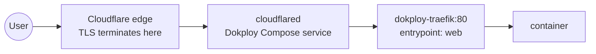

# Network

## Layout

- **Core:** MikroTik CRS310-8G+2S+IN (management IP `192.168.1.2`) does switching, VLANs, and inter-VLAN routing. VLAN plan in [ip-plan.md](../inventory/ip-plan.md).
- **Secondary switch:** SODOLA SL902-SWTGW218AS (managed), management IP `192.168.1.3` on VLAN 1. Uplink: SODOLA port 8 ↔ MikroTik `ether8`. Ports 1–3 take the Proxmox hosts' onboard 1G NICs (`pvemaster1`, `pvenode1`, `pvenode2`), used for [Wake-on-LAN](usb-2.5g-adapters.md#wake-on-lan-onboard-nics), on access VLAN 40; port 8 is a trunk (VLAN 1 untagged, 40 tagged). See the [SODOLA port map](../inventory/hardware.md#sodola-port-map). TODO: what else hangs off it.
- **Proxmox hosts:** each node's USB 2.5G adapter ([write-up](usb-2.5g-adapters.md)) backs `vmbr1`, a VLAN-aware bridge trunking VLANs 10/20/30/40. Management IP and per-VLAN host IPs live on `vmbr1`. `vmbr0`/`nic0` stay configured with no IP as a fallback.
- TODO: export and commit the MikroTik config (`/export hide-sensitive file=mikrotik`) to a `network/mikrotik.rsc`.

## External exposure



- **Pattern B:** Cloudflare Tunnel → Dokploy Traefik → container.
- Public services live under `*.homelab.capilabs.dev` (dedicated subdomain — no more flattening for wildcard SSL).
- Local-only access under `*.home.capilabs.dev`, resolved by Technitium to Traefik directly, TLS via Traefik's `cloudflare` certresolver (DNS challenge). See the label pattern in [dokploy-swarm.md](../platforms/dokploy-swarm.md#traefik-labels).
- Options evaluated for exposure: WireGuard, Tailscale, Headscale, Cloudflare Tunnel.

## Tailscale

Installed directly on the host OS (not in containers) on every infrastructure node. IPs and subnet routes are in [ip-plan.md](../inventory/ip-plan.md#tailscale).

- **Proxmox hosts** (`pvemaster1`, `pvenode1`, `pvenode2`) — admin access, and they advertise the VLAN subnet routes for remote access.
- **Swarm nodes** (`docker-dev-1`, `docker-worker-1`) — admin access. No `ufw` on `docker-dev-1`.

### Turn off Tailscale DNS on Proxmox nodes

Recommended for a hypervisor. With MagicDNS, all DNS on the node goes through
Tailscale. If Tailscale is down or not up yet at boot, the node can't resolve
anything, which can break `apt`, the Ceph/corosync hostnames you use, and
backups to remote storage.

Run on each Proxmox node. Leave Tailscale on, but have the node use Technitium
(`192.168.10.2`, `192.168.10.3`) directly, with Cloudflare as the last fallback.
Turning off Tailscale DNS also turns off split DNS for `home.capilabs.dev` on
the node, so pointing it at Technitium keeps `*.home.capilabs.dev` resolving:

```bash
tailscale set --accept-dns=false
pvesh set /nodes/$(hostname)/dns --search capilabs.dev --dns1 192.168.10.2 --dns2 192.168.10.3 --dns3 1.1.1.1
pvesh get /nodes/$(hostname)/dns
```

Check that both local and public names resolve:

```bash
getent hosts docs.home.capilabs.dev
getent hosts deb.debian.org
```

- The Technitium Primary runs in LXC 108 on `pvemaster1`. While that node
  boots, the container isn't up yet, so lookups fall back to `192.168.10.3`
  and then `1.1.1.1`.
- `1.1.1.1` is only used if neither Technitium server answers. If Technitium
  answers `NXDOMAIN`, the lookup fails without trying `1.1.1.1`, so Technitium
  must forward public queries upstream.

`tailscaled` has to be running for `tailscale set` to work. Otherwise it fails
with `dial unix /var/run/tailscale/tailscaled.sock: connect: no such file or
directory`. Check with `systemctl status tailscaled`.

**Applied** on all three Proxmox nodes (`pvemaster1`, `pvenode1`, `pvenode2`) on 2026-11-27.

### Remote access

How Docker apps and Kubernetes are reached from outside the house:

| What | Path |
|---|---|
| Public apps (`*.homelab.capilabs.dev`) | Cloudflare Tunnel — no Tailscale needed |
| Local apps (`*.home.capilabs.dev`) | Tailscale split DNS → Technitium (`192.168.10.2`) → subnet route to Traefik on VLAN 40 |
| Kubernetes (Headlamp, ingress, `kubectl`) | Subnet route to VLAN 30 (MetalLB `192.168.30.210–250`, API `192.168.30.10:6443`) |
| Proxmox / Docker hosts (SSH, UIs) | Directly on their Tailscale IPs |

- **Subnet routers:** `pvemaster1`, `pvenode1` and `pvenode2`, all advertising VLANs 10, 30, 40 (`pvemaster1` and `pvenode2` checked 2026-10-27), with IP forwarding enabled.
- **Split DNS:** Tailscale admin console → DNS → custom nameserver `192.168.10.2`, restricted to `home.capilabs.dev`.
- VLANs 1 and 20 are deliberately not advertised.

## DNS

- Technitium DNS Server, two-node cluster: **Primary** `192.168.10.2` (read/write) and **Secondary** `192.168.10.3` (read-only replica). See [current cluster](../services/technitium-dns-lxc.md#current-cluster).
- TODO: confirm DHCP and Tailscale split DNS hand out `192.168.10.3` as the second resolver (split DNS lists only `192.168.10.2` below).
- The Primary runs natively in LXC 108 on `pvemaster1` (moved off Docker Compose on `docker-dev-1`), so DNS doesn't depend on the Swarm stack.
- Build / rebuild / migrate: [Technitium DNS in an LXC](../services/technitium-dns-lxc.md) (script: `scripts/proxmox/create-technitium-lxc.sh`).
- TODO: list zones, conditional forwarders, upstream resolvers, and DHCP DNS settings.

## NFS

- DXP2800 exports NFS on VLAN 20 (`192.168.20.2`), mounted cluster-wide.
