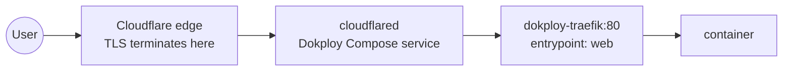

# Network

## Layout

- **Core:** MikroTik CRS310-8G+2S+IN does switching, VLANs, and inter-VLAN routing. VLAN plan in [ip-plan.md](../inventory/ip-plan.md).
- **Proxmox hosts:** each node's USB 2.5G adapter backs `vmbr1`, a VLAN-aware bridge trunking VLANs 10/20/30/40. Management IP and per-VLAN host IPs live on `vmbr1`. `vmbr0`/`nic0` stay configured with no IP as a fallback.
- TODO: export and commit the MikroTik config (`/export hide-sensitive file=mikrotik`) to a `network/mikrotik.rsc`.

## External exposure

- **Pattern B:** Cloudflare Tunnel → Dokploy Traefik → container.
- Public services live under `*.homelab.capilabs.dev` (dedicated subdomain — no more flattening for wildcard SSL).
- Local-only access under `*.home.capilabs.dev`, resolved by Technitium to Traefik directly, TLS via Traefik's `cloudflare` certresolver (DNS challenge). See the label pattern in [dokploy-swarm.md](../platforms/dokploy-swarm.md#traefik-labels).
- Options evaluated for exposure: WireGuard, Tailscale, Headscale, Cloudflare Tunnel → [ADR-0005](../decisions/0005-exposure-tunnel-plus-tailscale.md).

## Tailscale

Installed directly on (not in containers):

- Proxmox hosts — needed so corosync-qdevice can reach the EC2 QDevice.
- `docker-dev-1` (`100.64.122.124`) — no `ufw` on this host.
- `docker-worker-1`.
- EC2 QDevice (`100.109.27.36`).

Subnet route `192.168.1.0/24` advertised and approved. Known issue: Headlamp unreachable from mobile data over Tailscale — see [open-items](../open-items.md).

## DNS

- Technitium DNS Server at `192.168.10.2`.
- Being migrated from Docker Compose on `docker-dev-1` to a dedicated Proxmox LXC running natively, so DNS doesn't depend on the Swarm stack ([ADR-0007](../decisions/0007-dns-on-dedicated-lxc.md)).
- TODO: list zones, conditional forwarders, upstream resolvers, and DHCP DNS settings.

## NFS

- DXP2800 exports NFS on VLAN 20 (`192.168.20.2`), mounted cluster-wide.
- `Mem256` export: `exportfs` failed on hostname resolution — fixed by using IPs or `/etc/hosts` entries.
