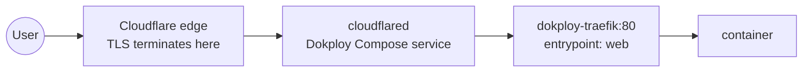

# Network

## Layout

- **Core:** MikroTik CRS310-8G+2S+IN does switching, VLANs, and inter-VLAN routing. VLAN plan in [ip-plan.md](../inventory/ip-plan.md).
- **Proxmox hosts:** each node's USB 2.5G adapter ([write-up](usb-2.5g-adapters.md)) backs `vmbr1`, a VLAN-aware bridge trunking VLANs 10/20/30/40. Management IP and per-VLAN host IPs live on `vmbr1`. `vmbr0`/`nic0` stay configured with no IP as a fallback.
- TODO: export and commit the MikroTik config (`/export hide-sensitive file=mikrotik`) to a `network/mikrotik.rsc`.

## External exposure

- **Pattern B:** Cloudflare Tunnel → Dokploy Traefik → container.
- Public services live under `*.homelab.capilabs.dev` (dedicated subdomain — no more flattening for wildcard SSL).
- Local-only access under `*.home.capilabs.dev`, resolved by Technitium to Traefik directly, TLS via Traefik's `cloudflare` certresolver (DNS challenge). See the label pattern in [dokploy-swarm.md](../platforms/dokploy-swarm.md#traefik-labels).
- Options evaluated for exposure: WireGuard, Tailscale, Headscale, Cloudflare Tunnel.

## Tailscale

Installed directly on the host OS (not in containers) on every infrastructure node. IPs and subnet routes are in [ip-plan.md](../inventory/ip-plan.md#tailscale).

- **Proxmox hosts** (`pvemaster1`, `pvenode1`, `pvenode2`) — admin access, and they advertise the VLAN subnet routes for remote access.
- **Swarm nodes** (`docker-dev-1`, `docker-worker-1`) — admin access. No `ufw` on `docker-dev-1`.

### Remote access

How Docker apps and Kubernetes are reached from outside the house:

| What | Path |
|---|---|
| Public apps (`*.homelab.capilabs.dev`) | Cloudflare Tunnel — no Tailscale needed |
| Local apps (`*.home.capilabs.dev`) | Tailscale split DNS → Technitium (`192.168.10.2`) → subnet route to Traefik on VLAN 40 |
| Kubernetes (Headlamp, ingress, `kubectl`) | Subnet route to VLAN 30 (MetalLB `192.168.30.210–250`, API `192.168.30.10:6443`) |
| Proxmox / Docker hosts (SSH, UIs) | Directly on their Tailscale IPs |

- **Subnet routers:** `pvemaster1`, `pvenode1` and `pvenode2`, all advertising VLANs 10, 30, 40 (`pvemaster1` and `pvenode2` checked 2026-10-27), with IP forwarding enabled.
- **Split DNS:** Tailscale admin console → DNS → custom nameserver `192.168.10.2`, restricted to `home.capilabs.dev`.
- VLANs 1 and 20 are deliberately not advertised.

## DNS

- Technitium DNS Server at `192.168.10.2`.
- Runs natively in LXC 108 on `pvemaster1` (moved off Docker Compose on `docker-dev-1`), so DNS doesn't depend on the Swarm stack.
- TODO: list zones, conditional forwarders, upstream resolvers, and DHCP DNS settings.

## NFS

- DXP2800 exports NFS on VLAN 20 (`192.168.20.2`), mounted cluster-wide.
