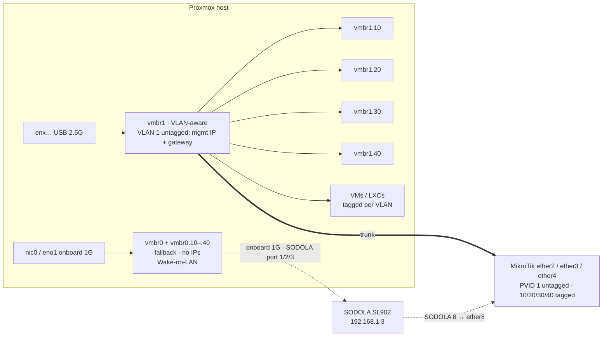
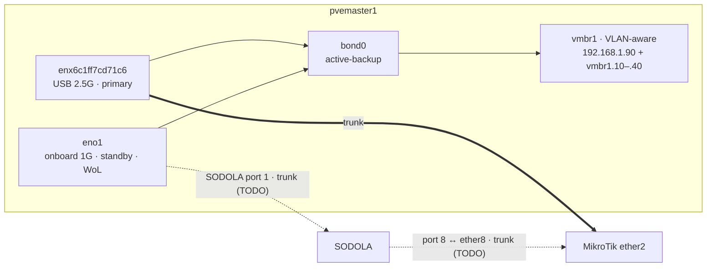

# 2.5G USB adapters on the Proxmox hosts

The Proxmox hosts ship with a 1G onboard NIC. The switch, NAS and workstation all do 2.5G, so the hosts were the bottleneck for VM traffic, NFS and node-to-node transfers. Each host got a USB 2.5G adapter, and all host networking was moved onto it.

## Hardware

| Host | Adapter | Chipset | Interface | Switch port |
|---|---|---|---|---|
| `pvemaster1` (HP Elite Mini 800 G9) | UGREEN USB 3.0 → 2.5G Ethernet (moved over from the old HP) | Realtek RTL8156B | `enx6c1ff7cd71c6` (driver `r8152`, 2500 Mbit/s) | ether2 |
| `pvenode2` (HP Pro Mini 400 G9, formerly `pvemaster1`) | UGREEN USB 3.0 → 2.5G Ethernet | Realtek RTL8156B | `enx6c1ff7cd73e3` (driver `r8152`, 2500 Mbit/s; was `nic1` on 2026-10-27) | ether4 |
| `pvenode1` (Dell OptiPlex Micro 7010) | UGREEN USB 3.0 → 2.5G Ethernet | Realtek RTL8156B | `enx6c1ff7cd73a6` (`usb-0000:00:14.0-4`) | ether3 |

- The interface names are MAC-based (`enx<mac>`), so they stay stable across reboots and re-plugging into a different USB port.
- Plug the adapters into a **USB 3.x port** — on USB 2.0 they cap at ~300 Mbit/s.
- Cat5e cabling is fine for 2.5G.

## Design



- **`vmbr1`** is a VLAN-aware Linux bridge on the USB adapter, restricted to `bridge-vids 10 20 30 40`. It carries the host's management IP and default gateway (`192.168.1.1`) on VLAN 1 (untagged), and the guests' tagged traffic.
- **Host VLAN interfaces** `vmbr1.10`, `.20`, `.30`, `.40` give each host an address on every VLAN (`.5` on `pvemaster1`, `.6` on `pvenode1`, `.7` on `pvenode2` — see [ip-plan](../inventory/ip-plan.md#proxmox-hosts)). This is what lets the hosts mount NFS on VLAN 20 directly, without routing through the MikroTik.
- **`vmbr0`** on the onboard 1G NIC is kept fully configured — including `vmbr0.10–.40` — but with **no IPs**. If the USB adapter dies, moving the IPs back to `vmbr0` (and the cable to the onboard port) restores the host without rebuilding the config. All three nodes have it: `eno1` on `pvemaster1`, `nic0` on `pvenode1` and `pvenode2`.
- **Onboard NICs (since 2026-11-27):** cabled to the SODOLA on all three nodes for **Wake-on-LAN** only. `vmbr0` still has no IP. See [Wake-on-LAN](#wake-on-lan-onboard-nics).
- **Switch side:** each host's USB adapter is on a MikroTik trunk port: PVID 1 / VLAN 1 untagged, VLANs 10, 20, 30, 40 tagged. See the [switch port map](../inventory/hardware.md#switch-port-map). The onboard 1G ports go to the **SODOLA** switch (`192.168.1.3`), not the MikroTik: `pvemaster1` port 1, `pvenode1` port 2, `pvenode2` port 3. The SODOLA uplinks from its port 8 to MikroTik `ether8`. See the [SODOLA port map](../inventory/hardware.md#sodola-port-map). TODO: the VLANs on those ports.

## How it was rolled out

Staged, one host at a time — `pvemaster1` first, then `pvenode1` — so the cluster always had one untouched node. `pvenode2` was not part of this rollout: it was a fresh install on 2026-10-27 that went straight onto `vmbr1` with the USB adapter, with no staging and no `vmbr0` fallback.

1. Add `vmbr1` on the USB adapter with no IP and confirm link.
2. Move the per-VLAN host IPs to `vmbr1.x` and test each.
3. Move the management IP and gateway from `vmbr0` to `vmbr1`; confirm cluster/corosync health.
4. Strip the IPs from `vmbr0`, leaving it as the fallback.

## Results

- iperf3 directly between `pvenode1` and `pvemaster1` over the adapters: **~2.35 Gbit/s sustained** — close to line rate for 2.5G.
- `pvemaster1` and `pvenode1` confirmed reachable on all VLANs after the migration. `pvenode2` was set up directly on `vmbr1`, with host addresses `.1.92` and `.10.7`–`.40.7`, checked on the host on 2026-10-27.
- The 2.35 Gbit/s figure was measured on the old `pvemaster1` HP Pro Mini, which is now `pvenode2`, so it is the same adapter-and-host pair. TODO: re-run iperf3 on `pvenode2` itself after the rename and re-cabling.

## Network config

Actual `/etc/network/interfaces` from each node (PVE's autogenerated header trimmed). The unused onboard and Wi-Fi interfaces are defined as `manual`.

Notes:

- `bridge-vids 10 20 30 40` on the bridges limits the VLANs the bridge will pass to exactly the ones in use.
- The `#` comment under each `vmbr0` stanza records the address/gateway to move back if the USB adapter fails.
- On every node the onboard NIC has `auto` and a `post-up ethtool -s <nic> wol g` in its own stanza, for [Wake-on-LAN](#wake-on-lan-onboard-nics).
- On `pvemaster1`, the `vmbr0.x` stanzas also keep their old addresses commented out, so failback is uncommenting rather than retyping. They are the same as the live `vmbr1.x` addresses, so uncomment them only after removing them from `vmbr1.x`, or the host has duplicate IPs.

=== "pvemaster1"

    As of 2026-11-27, after the onboard NIC was set up for Wake-on-LAN. Comments are as the PVE GUI left them. TODO: replace with a fresh `cat /etc/network/interfaces` from the host; this was written from the planned change.

    ```
    auto lo
    iface lo inet loopback

    # --- onboard 1G: Wake-on-LAN only, no IP ---
    auto eno1
    iface eno1 inet manual
            post-up /usr/sbin/ethtool -s eno1 wol g

    iface wlp0s20f3 inet manual

    auto enx6c1ff7cd71c6
    iface enx6c1ff7cd71c6 inet manual

    auto vmbr0
    iface vmbr0 inet manual
            bridge-ports eno1
            bridge-stp off
            bridge-fd 0
            bridge-vlan-aware yes
            bridge-vids 10 20 30 40
    #Node ETH port - WoL only, no IP. Failback: address 192.168.1.90/24 gateway 192.168.1.1

    auto vmbr0.10
    iface vmbr0.10 inet manual
    #       address 192.168.10.5/24
    #interf for VLAN10

    auto vmbr0.20
    iface vmbr0.20 inet manual
    #       address 192.168.20.5/24
    #interf for VLAN 20

    auto vmbr0.30
    iface vmbr0.30 inet manual
    #       address 192.168.30.5/24
    #interf for VLAN 30

    auto vmbr0.40
    iface vmbr0.40 inet manual
    #       address 192.168.40.5/24
    #interf for VLAN 40

    # --- active: USB 2.5G ---
    auto vmbr1
    iface vmbr1 inet static
            address 192.168.1.90/24
            gateway 192.168.1.1
            bridge-ports enx6c1ff7cd71c6
            bridge-stp off
            bridge-fd 0
            bridge-vlan-aware yes
            bridge-vids 10 20 30 40
    #USB 2.5GBPS - - address 192.168.1.90/24        gateway 192.168.1.1

    auto vmbr1.10
    iface vmbr1.10 inet static
            address 192.168.10.5/24
    #       address 192.168.10.5/24interf for VLAN10

    auto vmbr1.20
    iface vmbr1.20 inet static
            address 192.168.20.5/24
    #       address 192.168.20.5/24interf for VLAN 20

    auto vmbr1.30
    iface vmbr1.30 inet static
            address 192.168.30.5/24
    #       address 192.168.30.5/24interf for VLAN30

    auto vmbr1.40
    iface vmbr1.40 inet static
            address 192.168.40.5/24
    #       address 192.168.40.5/24interf for VLAN40

    source /etc/network/interfaces.d/*
    ```

    The `# --- … ---` section headers are added here for readability and aren't in the file.

=== "pvenode1"

    As of 2026-11-27, with the onboard NIC set up for Wake-on-LAN (the same change as `pvemaster1`). Written from the owner's paste plus that change. TODO: replace with a fresh `cat /etc/network/interfaces` from the host.

    ```
    auto lo
    iface lo inet loopback

    # --- onboard 1G: Wake-on-LAN only, no IP ---
    auto nic0
    iface nic0 inet manual
            post-up /usr/sbin/ethtool -s nic0 wol g

    iface nic1 inet manual

    iface wlp2s0 inet manual

    auto enx6c1ff7cd73a6
    iface enx6c1ff7cd73a6 inet manual

    auto vmbr0
    iface vmbr0 inet manual
            bridge-ports nic0
            bridge-stp off
            bridge-fd 0
            bridge-vlan-aware yes
            bridge-vids 10 20 30 40
    #Node ETH port - WoL only, no IP. Failback: address 192.168.1.91/24 gateway 192.168.1.1

    auto vmbr0.10
    iface vmbr0.10 inet manual

    auto vmbr0.20
    iface vmbr0.20 inet manual

    auto vmbr0.30
    iface vmbr0.30 inet manual

    auto vmbr0.40
    iface vmbr0.40 inet manual

    # --- active: USB 2.5G ---
    auto vmbr1
    iface vmbr1 inet static
            address 192.168.1.91/24
            gateway 192.168.1.1
            bridge-ports enx6c1ff7cd73a6
            bridge-stp off
            bridge-fd 0
            bridge-vlan-aware yes
            bridge-vids 10 20 30 40

    auto vmbr1.10
    iface vmbr1.10 inet static
            address 192.168.10.6/24

    auto vmbr1.20
    iface vmbr1.20 inet static
            address 192.168.20.6/24

    auto vmbr1.30
    iface vmbr1.30 inet static
            address 192.168.30.6/24

    auto vmbr1.40
    iface vmbr1.40 inet static
            address 192.168.40.6/24

    source /etc/network/interfaces.d/*
    ```

=== "pvenode2"

    Originally a fresh install (2026-10-27) with only `vmbr1`. It now has a `vmbr0` fallback on `nic0`, like the other nodes, and the USB adapter shows as `enx6c1ff7cd73e3` (it was Proxmox's pinned name `nic1` on 2026-10-27). As of 2026-11-27, with the onboard NIC set up for Wake-on-LAN (the same change as `pvemaster1`). Written from the owner's paste plus that change. TODO: replace with a fresh `cat /etc/network/interfaces` from the host.

    ```
    auto lo
    iface lo inet loopback

    # --- onboard 1G: Wake-on-LAN only, no IP ---
    auto nic0
    iface nic0 inet manual
            post-up /usr/sbin/ethtool -s nic0 wol g

    iface wlp2s0 inet manual

    auto enx6c1ff7cd73e3
    iface enx6c1ff7cd73e3 inet manual

    auto vmbr0
    iface vmbr0 inet manual
            bridge-ports nic0
            bridge-stp off
            bridge-fd 0
            bridge-vlan-aware yes
            bridge-vids 10 20 30 40
    #Node ETH port - WoL only, no IP. Failback: address 192.168.1.92/24 gateway 192.168.1.1

    auto vmbr0.10
    iface vmbr0.10 inet manual

    auto vmbr0.20
    iface vmbr0.20 inet manual

    auto vmbr0.30
    iface vmbr0.30 inet manual

    auto vmbr0.40
    iface vmbr0.40 inet manual

    # --- active: USB 2.5G ---
    auto vmbr1
    iface vmbr1 inet static
            address 192.168.1.92/24
            gateway 192.168.1.1
            bridge-ports enx6c1ff7cd73e3
            bridge-stp off
            bridge-fd 0
            bridge-vlan-aware yes
            bridge-vids 10 20 30 40

    auto vmbr1.10
    iface vmbr1.10 inet static
            address 192.168.10.7/24

    auto vmbr1.20
    iface vmbr1.20 inet static
            address 192.168.20.7/24

    auto vmbr1.30
    iface vmbr1.30 inet static
            address 192.168.30.7/24

    auto vmbr1.40
    iface vmbr1.40 inet static
            address 192.168.40.7/24

    source /etc/network/interfaces.d/*
    ```

## Wake-on-LAN (onboard NICs)

Each node's onboard 1G NIC is cabled to the SODOLA switch only so the host can be woken from power-off. The USB adapters can't be relied on for that, because USB ports usually lose power when the host is off. Magic packets are matched on the NIC's MAC, below the IP layer, so the onboard NIC has link and WoL enabled but **no IP**. `vmbr0` stays the no-IP fallback bridge. Configured on all three nodes on 2026-11-27.

| Host | NIC | MAC | SODOLA port | BIOS |
|---|---|---|---|---|
| `pvemaster1` | `eno1` | `7c:57:58:5d:a2:e4` | 1 | HP: Wake-on-LAN on, S5 maximum power savings off. TODO: confirm |
| `pvenode1` | `nic0` | `20:88:10:97:b9:44` | 2 | Dell: Wake on LAN = LAN only, Deep Sleep Control off. TODO: confirm |
| `pvenode2` | `nic0` | `30:13:8b:81:e4:a8` | 3 | HP: Wake-on-LAN on, S5 maximum power savings off. TODO: confirm |

The config, in the onboard NIC's own stanza (`eno1` on `pvemaster1`, `nic0` on the others), with no `address`/`gateway` on `vmbr0`:

```
auto nic0
iface nic0 inet manual
        post-up /usr/sbin/ethtool -s nic0 wol g
```

History (2026-11-27): the onboard NICs were first enabled with an IP and a second `gateway` on `vmbr0` (`192.168.1.100`–`.102`). That put two interfaces on `192.168.1.0/24` (see [gotchas](../gotchas.md#proxmox-storage-network)). The WoL `post-up` was also at the end of the file, so it ran as part of `vmbr1.40` and targeted the USB adapter. Fixed the same day on all three nodes: the address and gateway were removed, and WoL moved to the onboard NIC's stanza.

Check on each host (`eno1` on `pvemaster1`, `nic0` on the others):

```bash
NIC=nic0
ip -br addr show vmbr0              # no IPv4
ip route show default               # exactly one, via vmbr1
ethtool $NIC | grep -E 'Wake-on|Link detected'   # Wake-on: g, Link detected: yes
```

TODO: paste the check output from each node.

Wake a node from another one. The packet goes out on VLAN 1, untagged, through the MikroTik (`ether8`) and the SODOLA (port 8 → port 1/2/3):

```bash
apt install -y etherwake            # once, on the sending node
etherwake -i vmbr1 7c:57:58:5d:a2:e4   # pvemaster1
etherwake -i vmbr1 20:88:10:97:b9:44   # pvenode1
etherwake -i vmbr1 30:13:8b:81:e4:a8   # pvenode2
```

TODO: record whether a wake from full power-off works on each node. SODOLA ports 1–3 and 8 must have VLAN 1 untagged.

## Failback to the onboard NIC

If a USB adapter dies:

1. Move the cable from the adapter to the onboard port (same MikroTik port, so the trunk config still applies). The onboard ports' own cables go to the SODOLA. That path only works for failback if the SODOLA port and its uplink carry VLANs 10–40 tagged. TODO: check; until then, use the MikroTik cable.
2. In `/etc/network/interfaces`, move `address`/`gateway` from `vmbr1` to `vmbr0`, and each `vmbr1.x` address to `vmbr0.x` (on `pvemaster1`, just uncomment them).
3. Remove the addresses from `vmbr1` / `vmbr1.x`, then `ifreload -a`.
4. Check `pvecm status` and that the node rejoined.

Expect 1G speeds until the adapter is replaced.

## Risks and things to watch

- **Single point of failure.** All host traffic, including corosync, runs over one USB adapter per host. If one fails, that node drops out of the cluster until it's switched to `vmbr0`. Planned fix: [active-backup bond](#future-enhancement-active-backup-bond).
- **Driver.** All three adapters use the `r8152` driver (the better choice over generic `cdc_ncm`), firmware `rtl8156b-2 v3 10/20/23`, on kernel `7.0.14-16-pve`. Re-check with `ethtool -i enx…` after kernel upgrades.
- **USB autosuspend.** If an adapter ever drops link under low traffic, disable USB autosuspend for it.
- **Kernel updates.** After a Proxmox kernel upgrade, re-run a quick iperf3 to confirm speed and driver are unchanged.

## Upgrade path

- `pvenode2` (HP Pro Mini 400 G9) can take an **HP Flex IO V2 2.5GbE module** (Intel i225-V), giving a native 2.5G NIC to replace the USB adapter.
- `pvenode1` (Dell OptiPlex Micro 7010) has no NIC expansion option, so it stays on USB until it's replaced.

## Future enhancement: active-backup bond

**Status:** idea, not applied. It would replace the manual [failback](#failback-to-the-onboard-nic) with automatic failover, and fix the "single point of failure" risk [above](#risks-and-things-to-watch).

Bond the USB 2.5G adapter (primary) and the onboard 1G NIC (standby) in **active-backup** mode and put `vmbr1` on the bond. The host keeps one IP (`192.168.1.90`), so nothing changes for corosync or the guests. No LACP is needed on the switches, which matters because the two NICs go to different switches (MikroTik and SODOLA). Two IPs on two NICs in the same subnet is not a substitute, see [gotchas](../gotchas.md#proxmox-storage-network).



### Config (pvemaster1)

`vmbr0` and `vmbr0.10`–`.40` go away: `eno1` becomes a bond member, so the fallback bridge isn't needed. Everything from `vmbr1` up (IPs, VLAN interfaces, guest NICs) stays the same, only `bridge-ports` changes.

```
auto lo
iface lo inet loopback

auto eno1
iface eno1 inet manual
        post-up /usr/sbin/ethtool -s eno1 wol g

auto enx6c1ff7cd71c6
iface enx6c1ff7cd71c6 inet manual

iface wlp0s20f3 inet manual

auto bond0
iface bond0 inet manual
        bond-slaves enx6c1ff7cd71c6 eno1
        bond-mode active-backup
        bond-primary enx6c1ff7cd71c6
        bond-miimon 100
#Active-backup: USB 2.5G primary, onboard 1G standby

auto vmbr1
iface vmbr1 inet static
        address 192.168.1.90/24
        gateway 192.168.1.1
        bridge-ports bond0
        bridge-stp off
        bridge-fd 0
        bridge-vlan-aware yes
        bridge-vids 10 20 30 40

auto vmbr1.10
iface vmbr1.10 inet static
        address 192.168.10.5/24

auto vmbr1.20
iface vmbr1.20 inet static
        address 192.168.20.5/24

auto vmbr1.30
iface vmbr1.30 inet static
        address 192.168.30.5/24

auto vmbr1.40
iface vmbr1.40 inet static
        address 192.168.40.5/24

source /etc/network/interfaces.d/*
```

- `bond-primary` keeps traffic on the 2.5G link, and moves it back there when that link recovers.
- `bond-miimon 100` checks link every 100 ms. On failover the bond sends gratuitous ARPs so the switches learn the new path.
- In active-backup the standby NIC doesn't transmit and drops what it receives, so there's no loop between the two switches.

`pvenode1` and `pvenode2` follow the same pattern with their own interface names.

### Switch side (do this first)

The standby path is `eno1` → SODOLA → uplink → MikroTik. It must carry the same VLANs as `ether2`, or a failover keeps VLAN 1 but loses NFS (VLAN 20) and the guest VLANs.

- **SODOLA, host ports** (1 `pvemaster1`, 2 `pvenode1`, 3 `pvenode2`): PVID 1, VLAN 1 untagged, VLANs 10/20/30/40 tagged.
- **SODOLA, port 8 (uplink):** the same VLANs.
- **MikroTik `ether8`:** add it to VLANs 10–40 tagged. `set tagged=` replaces the list, so the existing ports are included:

```
/interface bridge vlan set [find vlan-ids=10] tagged=bridge,ether2,ether3,ether4,ether8
/interface bridge vlan set [find vlan-ids=20] tagged=bridge,ether2,ether3,ether4,ether8
/interface bridge vlan set [find vlan-ids=30] tagged=bridge,ether2,ether3,ether4,ether8
/interface bridge vlan set [find vlan-ids=40] tagged=bridge,ether2,ether3,ether4,ether8
```

### Apply and test

Do it from the console or the [Comet X KVM](../inventory/hardware.md#remote-management-kvm), not over SSH. A typo takes the host off the network.

```bash
grep -l vmbr0 /etc/pve/qemu-server/*.conf /etc/pve/lxc/*.conf   # must list nothing
cp /etc/network/interfaces /etc/network/interfaces.bak-$(date +%F)
# edit /etc/network/interfaces, then:
ifreload -a
cat /proc/net/bonding/bond0        # Currently Active Slave: enx6c1ff7cd71c6, both slaves "MII Status: up"
pvecm status
```

Failover test: run `ping 192.168.1.91` from `pvemaster1` and pull the USB adapter's cable. At most a packet or two should be lost, and `/proc/net/bonding/bond0` should show `eno1` active. Plug the cable back in and traffic should go back to the adapter.

### Caveats

- **A USB adapter that drops off the bus isn't the same as losing link.** If it disappears completely (USB reset), the bond fails over, but the adapter may not rejoin the bond when it comes back until `ifreload -a` is run.
- **Wake-on-LAN MAC.** In a bond, `eno1` takes the bond's MAC (the USB adapter's). TODO: test whether a wake from power-off works with `eno1`'s own MAC (`7c:57:58:5d:a2:e4`) or needs the bond's MAC.
- **Corosync.** The bond covers a NIC or cable failure on the host. To also survive a switch failure, the usual Proxmox approach is a second corosync link (`link1`) on its own subnet, alongside the bond.
