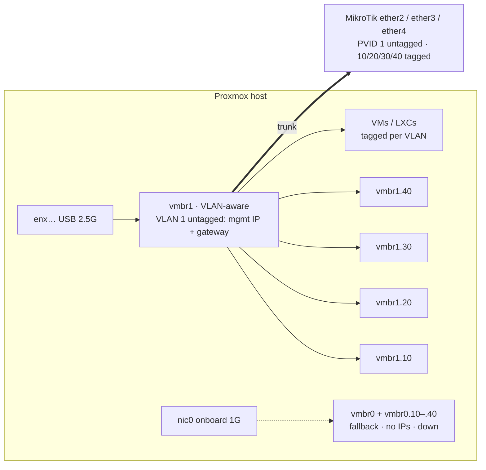

# 2.5G USB adapters on the Proxmox hosts

> **Update 2026-10-27:** a third machine arrived and the hostnames changed. The HP Pro Mini 400 G9 below is now **`pvenode2`** (`192.168.1.92`); the new hardware runs the cloned old-`pvemaster1` disk as **`pvemaster1`**. The USB adapter `enx6c1ff7cd71c6` moved to the new `pvemaster1` (HP Elite Mini 800 G9) and is up at 2.5 Gbit/s (driver `r8152`), so the `pvemaster1` config below still works unchanged. `pvenode2` has a different adapter (`nic1`, MAC `6c:1f:f7:cd:73:e3`), and a plain one-bridge config on `vmbr1` — see its tab below. On the new hardware the onboard NIC is `eno1` and the Wi-Fi is `wlp0s20f3`, so the `pvemaster1` tab uses those names (verified 2026-10-27).

The Proxmox hosts ship with a 1G onboard NIC. The switch, NAS and workstation all do 2.5G, so the hosts were the bottleneck for VM traffic, NFS and node-to-node transfers. Each host got a USB 2.5G adapter, and all host networking was moved onto it.

## Hardware

| Host | Adapter | Chipset | Interface | Switch port |
|---|---|---|---|---|
| `pvemaster1` (HP Elite Mini 800 G9) | UGREEN USB 3.0 → 2.5G Ethernet (moved over from the old HP) | Realtek RTL8156B | `enx6c1ff7cd71c6` (driver `r8152`, 2500 Mbit/s) | ether2 |
| `pvenode2` (HP Pro Mini 400 G9, formerly `pvemaster1`) | UGREEN USB 3.0 → 2.5G Ethernet | Realtek RTL8156B | `nic1` (MAC `6c:1f:f7:cd:73:e3`, driver `r8152`, 2500 Mbit/s) | ether4 |
| `pvenode1` (Dell OptiPlex Micro 7010) | UGREEN USB 3.0 → 2.5G Ethernet | Realtek RTL8156B | `enx6c1ff7cd73a6` (`usb-0000:00:14.0-4`) | ether3 |

- The interface names are MAC-based (`enx<mac>`), so they stay stable across reboots and re-plugging into a different USB port.
- Plug the adapters into a **USB 3.x port** — on USB 2.0 they cap at ~300 Mbit/s.
- Cat5e cabling is fine for 2.5G.

## Design



- **`vmbr1`** is a VLAN-aware Linux bridge on the USB adapter, restricted to `bridge-vids 10 20 30 40`. It carries the host's management IP and default gateway (`192.168.1.1`) on VLAN 1 (untagged), and the guests' tagged traffic.
- **Host VLAN interfaces** `vmbr1.10`, `.20`, `.30`, `.40` give each host an address on every VLAN (`.5` on `pvemaster1`, `.6` on `pvenode1` — see [ip-plan](../inventory/ip-plan.md#proxmox-hosts)). This is what lets the hosts mount NFS on VLAN 20 directly, without routing through the MikroTik.
- **`vmbr0`** on the onboard 1G NIC is kept fully configured — including `vmbr0.10–.40` — but with **no IPs**. If the USB adapter dies, moving the IPs back to `vmbr0` (and the cable to the onboard port) restores the host without rebuilding the config.
- **Switch side:** each host's port is a trunk — PVID 1 / VLAN 1 untagged, VLANs 10, 20, 30, 40 tagged. See the [switch port map](../inventory/hardware.md#switch-port-map).

## How it was rolled out

Staged, one host at a time — `pvemaster1` first, then `pvenode1` — so the cluster always had one untouched node.

1. Add `vmbr1` on the USB adapter with no IP and confirm link.
2. Move the per-VLAN host IPs to `vmbr1.x` and test each.
3. Move the management IP and gateway from `vmbr0` to `vmbr1`; confirm cluster/corosync health.
4. Strip the IPs from `vmbr0`, leaving it as the fallback.

## Results

- iperf3 directly between `pvenode1` and `pvemaster1` over the adapters: **~2.35 Gbit/s sustained** — close to line rate for 2.5G.
- Both hosts confirmed reachable on all VLANs after the migration.

## Network config

Actual `/etc/network/interfaces` from each node (PVE's autogenerated header trimmed). The unused onboard and Wi-Fi interfaces are defined as `manual`.

Notes:

- `bridge-vids 10 20 30 40` on both bridges limits the VLANs the bridge will pass to exactly the ones in use.
- The `#` comment under each `vmbr0` stanza records the address/gateway to move back if the USB adapter fails.
- On `pvemaster1`, the `vmbr0.x` stanzas also keep their old addresses commented out, so failback is uncommenting rather than retyping.

=== "pvemaster1"

    ```
    auto lo
    iface lo inet loopback

    iface eno1 inet manual
    iface wlp0s20f3 inet manual

    source /etc/network/interfaces.d/*

    auto enx6c1ff7cd71c6
    iface enx6c1ff7cd71c6 inet manual

    # --- fallback: onboard 1G, no IPs ---
    auto vmbr0
    iface vmbr0 inet manual
            bridge-ports eno1
            bridge-stp off
            bridge-fd 0
            bridge-vlan-aware yes
            bridge-vids 10 20 30 40
    #Node ETH port (NOT USED) - address 192.168.1.90/24     gateway 192.168.1.1

    auto vmbr0.10
    iface vmbr0.10 inet manual
    #       address 192.168.10.5/24

    auto vmbr0.20
    iface vmbr0.20 inet manual
    #       address 192.168.20.5/24

    auto vmbr0.30
    iface vmbr0.30 inet manual
    #       address 192.168.30.5/24

    auto vmbr0.40
    iface vmbr0.40 inet manual
    #       address 192.168.40.5/24

    # --- active: USB 2.5G ---
    auto vmbr1
    iface vmbr1 inet static
            address 192.168.1.90/24
            gateway 192.168.1.1
            bridge-ports enx6c1ff7cd71c6
            bridge-stp off
            bridge-fd 0
            bridge-vlan-aware yes
            bridge-vids 10 20 30 40

    auto vmbr1.10
    iface vmbr1.10 inet static
            address 192.168.10.5/24

    auto vmbr1.20
    iface vmbr1.20 inet static
            address 192.168.20.5/24

    auto vmbr1.30
    iface vmbr1.30 inet static
            address 192.168.30.5/24

    auto vmbr1.40
    iface vmbr1.40 inet static
            address 192.168.40.5/24
    ```

=== "pvenode1"

    ```
    auto lo
    iface lo inet loopback

    iface nic0 inet manual
    iface nic1 inet manual
    iface wlp2s0 inet manual

    auto enx6c1ff7cd73a6
    iface enx6c1ff7cd73a6 inet manual

    # --- fallback: onboard 1G, no IPs ---
    auto vmbr0
    iface vmbr0 inet manual
            bridge-ports nic0
            bridge-stp off
            bridge-fd 0
            bridge-vlan-aware yes
            bridge-vids 10 20 30 40
    #Node ETH port (NOT USED) - address 192.168.1.91/24     gateway 192.168.1.1

    auto vmbr0.10
    iface vmbr0.10 inet manual
    auto vmbr0.20
    iface vmbr0.20 inet manual
    auto vmbr0.30
    iface vmbr0.30 inet manual
    auto vmbr0.40
    iface vmbr0.40 inet manual

    # --- active: USB 2.5G ---
    auto vmbr1
    iface vmbr1 inet static
            address 192.168.1.91/24
            gateway 192.168.1.1
            bridge-ports enx6c1ff7cd73a6
            bridge-stp off
            bridge-fd 0
            bridge-vlan-aware yes
            bridge-vids 10 20 30 40

    auto vmbr1.10
    iface vmbr1.10 inet static
            address 192.168.10.6/24

    auto vmbr1.20
    iface vmbr1.20 inet static
            address 192.168.20.6/24

    auto vmbr1.30
    iface vmbr1.30 inet static
            address 192.168.30.6/24

    auto vmbr1.40
    iface vmbr1.40 inet static
            address 192.168.40.6/24

    source /etc/network/interfaces.d/*
    ```

=== "pvenode2"

    Fresh install (2026-10-27): one VLAN-aware bridge on the USB adapter, no onboard-NIC fallback. The interface name `nic1` is Proxmox's pinned name, not the `enx<mac>` form used on the other nodes. The bridge is named `vmbr1` to match the other nodes, which guest migration requires.

    ```
    auto lo
    iface lo inet loopback

    iface nic0 inet manual
    iface nic1 inet manual

    auto vmbr1
    iface vmbr1 inet static
            address 192.168.1.92/24
            gateway 192.168.1.1
            bridge-ports nic1
            bridge-stp off
            bridge-fd 0
            bridge-vlan-aware yes
            bridge-vids 10 20 30 40

    auto vmbr1.10
    iface vmbr1.10 inet static
            address 192.168.10.7/24

    auto vmbr1.20
    iface vmbr1.20 inet static
            address 192.168.20.7/24

    auto vmbr1.30
    iface vmbr1.30 inet static
            address 192.168.30.7/24

    auto vmbr1.40
    iface vmbr1.40 inet static
            address 192.168.40.7/24

    source /etc/network/interfaces.d/*
    ```

## Failback to the onboard NIC

If a USB adapter dies (on `pvenode2`, whose onboard NIC `nic0` has no bridge yet, first create `vmbr0` with `bridge-ports nic0`):

1. Move the cable from the adapter to the onboard port (same switch port, so the trunk config still applies).
2. In `/etc/network/interfaces`, move `address`/`gateway` from `vmbr1` to `vmbr0`, and each `vmbr1.x` address to `vmbr0.x` (on `pvemaster1`, just uncomment them).
3. Remove the addresses from `vmbr1` / `vmbr1.x`, then `ifreload -a`.
4. Check `pvecm status` and that the node rejoined.

Expect 1G speeds until the adapter is replaced.

## Risks and things to watch

- **Single point of failure.** All host traffic, including corosync, runs over one USB adapter per host. If one fails, that node drops out of the cluster until it's switched to `vmbr0`.
- **Driver.** All three adapters use the `r8152` driver (the better choice over generic `cdc_ncm`), firmware `rtl8156b-2 v3 10/20/23`, on kernel `7.0.14-16-pve`. Re-check with `ethtool -i enx…` after kernel upgrades.
- **USB autosuspend.** If an adapter ever drops link under low traffic, disable USB autosuspend for it.
- **Kernel updates.** After a Proxmox kernel upgrade, re-run a quick iperf3 to confirm speed and driver are unchanged.

## Upgrade path

- `pvenode2` (HP Pro Mini 400 G9) can take an **HP Flex IO V2 2.5GbE module** (Intel i225-V), giving a native 2.5G NIC to replace the USB adapter.
- `pvenode1` (Dell OptiPlex Micro 7010) has no NIC expansion option, so it stays on USB until it's replaced.
