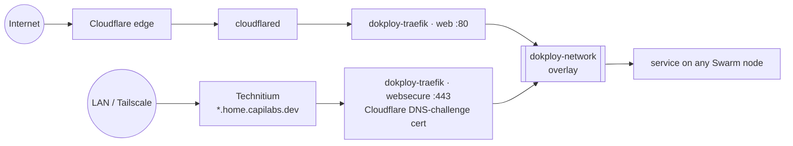
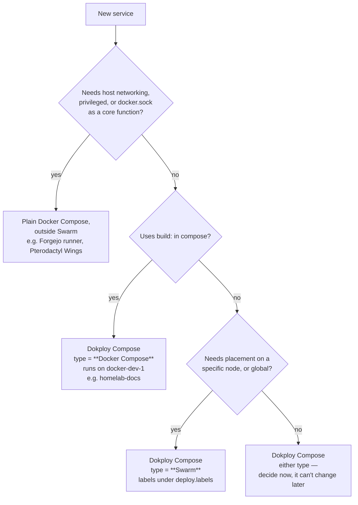

# Dokploy / Docker Swarm

## Nodes

| Node | Proxmox VM | Host | vCPU / RAM / Disk | IP (VLAN 40) | Tailscale | Swarm role |
|---|---|---|---|---|---|---|
| `docker-dev-1` | 104 (`docker`) | `pvemaster1` | 6 / 12 GB / 150 GB | 192.168.40.10 | 100.64.122.124 | Manager, runs Dokploy |
| `docker-worker-1` | 107 (`docker.worker.1`) | `pvenode1` | 6 / 8 GB / 100 GB | 192.168.40.11 | 100.69.115.109 | Worker |

- One node per Proxmox host, so losing a host leaves the other Swarm node running.
- Only one manager: if `docker-dev-1` is down, running services on the worker keep going, but nothing can be deployed or rescheduled until it's back.
- Disks are LVM (`ubuntu-vg/ubuntu-lv`). `docker-dev-1` was under-allocated at install (root LV 24 GB) — check every new node with `lsblk`.
- No `ufw` on `docker-dev-1`. Nothing is exposed directly; public traffic arrives via Cloudflare Tunnel, private via Tailscale.
- New nodes are cloned from template VM 109 (`docker-template-ubuntu-server-24.04.4`) — set the NIC's VLAN tag to 40 after cloning.
- Known issue: `docker-dev-1` advertises a stale Swarm address — see [open-items](../open-items.md).

## How traffic reaches a service



- **Traefik** runs as the `dokploy-traefik` container on `docker-dev-1`, publishing 80/tcp, 443/tcp and 443/udp (HTTP/3) on all of that VM's interfaces, IPv4 and IPv6. That's what Technitium points `*.home.capilabs.dev` at, and what Tailscale clients reach via the VLAN 40 route. Nothing on the home router forwards to it, so it isn't reachable from the internet directly.
- **cloudflared** runs as the `cloudflare_tunnel` container (image `cloudflare/cloudflared:latest`) on `docker-dev-1`, as a plain Docker Compose app rather than a Swarm service. It connects outbound to Cloudflare, so it needs no published ports. The `:latest` tag means a redeploy can pull a new version unannounced; pin a version if you want upgrades to be deliberate.
- Every routed service must join the external `dokploy-network` overlay — that's how Traefik on the manager reaches containers on the worker.
- `*.homelab.capilabs.dev` → public router; `*.home.capilabs.dev` → local router. A service can have either or both.

## Choosing how to deploy something



> ⚠️ **Compose Type (Docker Compose vs Swarm) is fixed when the Dokploy app is created.** Wrong type = delete and recreate.

## Compose conventions

### Volumes

Use a named volume backed by a local bind, not a bare bind mount:

```yaml
volumes:
  app-data:
    driver: local
    driver_opts:
      type: none
      o: bind
      device: /mnt/docker-storage/<app>/data
```

Create the host directory first — the bind driver won't.

### Traefik labels

Every service gets explicit `service=` on each router. Always set `traefik.docker.network=dokploy-network`.

**Public only (behind Cloudflare Tunnel):** plain `web` entrypoint, no certresolver — Cloudflare terminates TLS.

```yaml
labels:
  - traefik.enable=true
  - traefik.docker.network=dokploy-network
  - traefik.http.routers.<name>-public.rule=Host(`<name>.homelab.capilabs.dev`)
  - traefik.http.routers.<name>-public.entrypoints=web
  - traefik.http.routers.<name>-public.service=<name>
  - traefik.http.services.<name>.loadbalancer.server.port=<port>
```

**Local only (LAN + Tailscale):** e.g. the docs site.

```yaml
labels:
  - traefik.enable=true
  - traefik.docker.network=dokploy-network
  - traefik.http.routers.<name>-local.rule=Host(`<name>.home.capilabs.dev`)
  - traefik.http.routers.<name>-local.entrypoints=websecure
  - traefik.http.routers.<name>-local.tls.certresolver=cloudflare
  - traefik.http.routers.<name>-local.service=<name>
  - traefik.http.services.<name>.loadbalancer.server.port=<port>
```

**Public + local (dual router), confirmed working on Infisical:**

```yaml
labels:   # plain Docker Compose type → top-level labels
  - traefik.enable=true
  - traefik.docker.network=dokploy-network
  # public, via Cloudflare Tunnel
  - traefik.http.routers.<name>-public.rule=Host(`<name>.homelab.capilabs.dev`)
  - traefik.http.routers.<name>-public.entrypoints=web
  - traefik.http.routers.<name>-public.service=<name>
  # local, via Technitium → Traefik directly
  - traefik.http.routers.<name>-local.rule=Host(`<name>.home.capilabs.dev`)
  - traefik.http.routers.<name>-local.entrypoints=websecure
  - traefik.http.routers.<name>-local.tls.certresolver=cloudflare
  - traefik.http.routers.<name>-local.service=<name>
  - traefik.http.services.<name>.loadbalancer.server.port=<port>
```

**Swarm-type apps:** the same labels go under `deploy.labels`, **not** top-level `labels:`. Traefik's Swarm provider reads the service object; top-level labels are silently ignored.

```yaml
services:
  app:
    deploy:
      placement:
        constraints: [node.hostname == docker-worker-1]
      labels:
        - traefik.enable=true
        # ...same as above
```

### Redeploying

Dokploy's **Deploy** doesn't always recreate containers. After env or volume changes:

```bash
docker compose down && docker compose up -d     # compose-type apps
docker service update --force <stack>_<svc>      # swarm services
```

### Every service also needs

- The network declared as external:
  ```yaml
  networks:
    dokploy-network:
      external: true
  ```
- A DNS record: public names in Cloudflare (tunnel), local names in Technitium pointing at Traefik.
- A row in the [service catalog](../services/README.md).

### Secrets

Store in Infisical. TODO: document how apps pull from Infisical (env injection vs. CLI vs. Dokploy env).

## Health checks

```bash
docker node ls                                   # both nodes Ready / Active
docker stack ls                                  # Swarm-type Dokploy apps
docker service ls                                # replicas should read n/n
docker service ps <stack>_<svc> --no-trunc       # why a task won't start
docker network inspect dokploy-network --format '{{range .Peers}}{{.Name}} {{.IP}}{{"\n"}}{{end}}'  # both nodes listed as overlay peers
```

Logs for any container on either node: Dozzle. Resource usage: Beszel.
