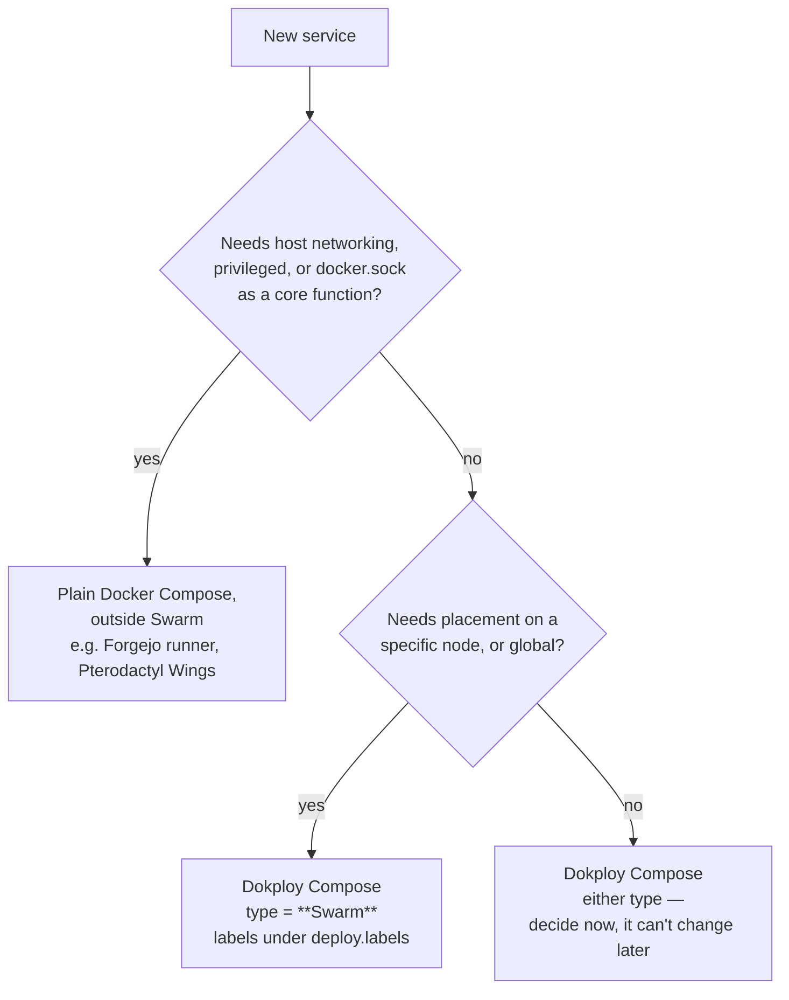

# Dokploy / Docker Swarm

## Nodes

| Node | IP | Tailscale | Swarm role |
|---|---|---|---|
| `docker-dev-1` | 192.168.40.10 | 100.64.122.124 | Manager, Dokploy |
| `docker-worker-1` | 192.168.40.11 | TODO | Worker |

- Both on VLAN 40 (APPS). `docker-dev-1` used to be 192.168.10.10 on VLAN 10.
- `docker-dev-1` disk: 150 GB, LVM. Was under-allocated (root LV 24 GB) — see [runbook](../runbooks/extend-lvm-root.md).
- No `ufw` on `docker-dev-1`.
- Known issue: stale Swarm advertise address — see [open-items](../open-items.md).

## Choosing how to deploy something



> ⚠️ **Compose Type (Docker Compose vs Swarm) is fixed when the Dokploy app is created.** Wrong type = delete and recreate.

## Compose conventions

### Volumes

Use a named volume backed by a local bind, not a bare bind mount:

```yaml
volumes:
  app-data:
    driver: local
    driver_opts:
      type: none
      o: bind
      device: /mnt/docker-storage/<app>/data
```

Create the host directory first — the bind driver won't.

### Traefik labels

Every service gets explicit `service=` on each router. Always set `traefik.docker.network=dokploy-network`.

**Public only (behind Cloudflare Tunnel):** plain `web` entrypoint, no certresolver — Cloudflare terminates TLS.

**Public + local (dual router), confirmed working on Infisical:**

```yaml
labels:   # plain Docker Compose type → top-level labels
  - traefik.enable=true
  - traefik.docker.network=dokploy-network
  # public, via Cloudflare Tunnel
  - traefik.http.routers.<name>-public.rule=Host(`<name>.homelab.capilabs.dev`)
  - traefik.http.routers.<name>-public.entrypoints=web
  - traefik.http.routers.<name>-public.service=<name>
  # local, via Technitium → Traefik directly
  - traefik.http.routers.<name>-local.rule=Host(`<name>.home.capilabs.dev`)
  - traefik.http.routers.<name>-local.entrypoints=websecure
  - traefik.http.routers.<name>-local.tls.certresolver=cloudflare
  - traefik.http.routers.<name>-local.service=<name>
  - traefik.http.services.<name>.loadbalancer.server.port=<port>
```

**Swarm-type apps:** the same labels go under `deploy.labels`, **not** top-level `labels:`. Traefik's Swarm provider reads the service object; top-level labels are silently ignored.

```yaml
services:
  app:
    deploy:
      placement:
        constraints: [node.hostname == docker-worker-1]
      labels:
        - traefik.enable=true
        # ...same as above
```

### Exposing a port to the LAN/tailnet

Swarm `mode: host` publishing binds on **all** of that node's interfaces — there's no `host_ip`. To limit a port to Tailscale only, add a host firewall rule.

```yaml
ports:
  - target: 5432
    published: 5432
    protocol: tcp
    mode: host
```

### Redeploying

Dokploy's **Deploy** doesn't always recreate containers. After env or volume changes:

```bash
docker compose down && docker compose up -d     # compose-type apps
docker service update --force <stack>_<svc>      # swarm services
```

### Secrets

Store in Infisical. TODO: document how apps pull from Infisical (env injection vs. CLI vs. Dokploy env).
