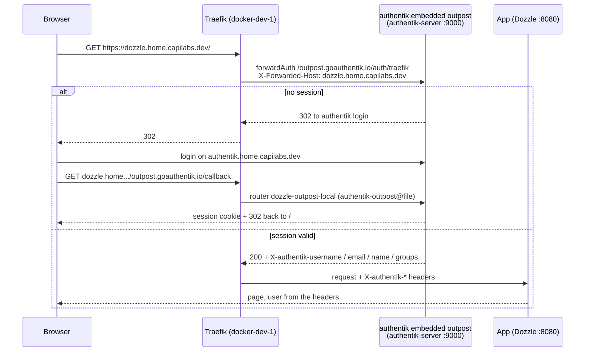

# authentik forward auth (Traefik)

SSO for apps that have no OIDC/SAML support of their own. Traefik asks authentik whether each
request is allowed before passing it to the app. authentik's **embedded outpost** (which runs inside
`authentik-server`) does the check, so there's no extra container.

| | |
|---|---|
| Traefik config | `dokploy/traefik/dynamic/authentik-fw.yml` → on `docker-dev-1` at `/etc/dokploy/traefik/dynamic/authentik-fw.yml` |
| Outpost | **authentik Embedded Outpost** (in `homelab-authentik-nwlvpq_authentik-server`) |
| Mode | Proxy provider, **Forward auth (single application)**, one provider per hostname |
| Apps using it | [Dozzle](dozzle.md) |

## How it works



Each protected app needs three things:

1. **authentik:** a proxy provider + application per hostname, added to the embedded outpost.
2. **Traefik app routers:** `middlewares=authentik@file` on **every** router of the app (public and local).
3. **Traefik outpost routers:** `Host(app) && PathPrefix(/outpost.goauthentik.io/)` → `authentik-outpost@file`,
   for the login callback and sign-out on the app's own hostname.

!!! warning
    Every router of a header-trusting app (Dozzle `forward-proxy`) must have the middleware.
    A router without it lets anyone send `X-authentik-username: admin` and be logged in as that
    user. On a protected router, Traefik replaces those headers with authentik's reply.

## Traefik dynamic config

`dokploy/traefik/dynamic/authentik-fw.yml` holds only the shared parts: two middlewares and the
service that points at the outpost. All routers are labels on each app.

| Name | Type | Used for |
|---|---|---|
| `authentik@file` | `forwardAuth` middleware | All app routers |
| `forwarded-https@file` | `headers` middleware, `X-Forwarded-Proto: https` | Public routers only, **before** `authentik@file` |
| `authentik-outpost@file` | service → `http://homelab-authentik-nwlvpq_authentik-server:9000` | The `<app>-outpost-*` routers |

Why `forwarded-https`: on the public path, Cloudflare terminates TLS and cloudflared hits Traefik's
`web` entrypoint over plain HTTP. Without it the outpost sees `http` and builds `http://` redirect
URLs. TODO: confirm a full login on a public URL.

The address uses the Swarm service name (`<stack>_<service>`), which resolves to the service VIP on
`dokploy-network`. Checked 2026-11-21 from `dokploy-traefik`: both the VIP and
`tasks.homelab-authentik-nwlvpq_authentik-server` answer `200` on `/-/health/live/`. If the authentik
stack is recreated under a new Dokploy name, update both URLs in the file.

Install or update it on the server (Traefik reloads the directory on its own):

```bash
# from the repo root on the workstation
scp dokploy/traefik/dynamic/authentik-fw.yml docker-dev-1:/tmp/authentik-fw.yml
ssh -t docker-dev-1 'sudo install -m 0644 /tmp/authentik-fw.yml /etc/dokploy/traefik/dynamic/authentik-fw.yml && rm /tmp/authentik-fw.yml'
```

Don't use the router/service block from authentik's Traefik docs example (`default-router`,
`service: app` → `http://ip.internal`, `service: authentik` with `/outpost.goauthentik.io` in the
URL). They're placeholders: they hijack the app's hostname and double the outpost path, and the
result is authentik's 404 page.

## Protecting an app

### 1. authentik

In `https://authentik.home.capilabs.dev/if/admin/`, once per hostname (local and public):

1. **Applications → Providers → Create → Proxy Provider**
    - Name: `<app>-local` / `<app>-public`
    - Authorization flow: `default-provider-authorization-implicit-consent`
    - Mode: **Forward auth (single application)**
    - External host: `https://<app>.home.capilabs.dev` / `https://<app>.homelab.capilabs.dev`
      (exact: `https`, no trailing slash, no path)
2. **Applications → Applications → Create**: same name, provider from step 1.
   Bind a group under **Policy / Group / User Bindings** to restrict who can open it.
   TODO: decide the admin group name and bind it on the Dozzle apps.
3. **Applications → Outposts → authentik Embedded Outpost → Edit**: add the application(s) to
   **Selected Applications** → **Update**. Easy to miss, and without it the outpost returns 404.

### 2. App labels

Under `deploy.labels` (Swarm), next to the app's normal routers:

```yaml
        # App routers: add the middlewares
        - traefik.http.routers.<app>-public.middlewares=forwarded-https@file,authentik@file
        - traefik.http.routers.<app>-local.middlewares=authentik@file

        # Outpost callback / sign_out on the app's own hostnames -> authentik
        - traefik.http.routers.<app>-outpost-public.rule=Host(`${PUBLIC_DOMAIN}`) && PathPrefix(`/outpost.goauthentik.io/`)
        - traefik.http.routers.<app>-outpost-public.entrypoints=web
        - traefik.http.routers.<app>-outpost-public.middlewares=forwarded-https@file
        - traefik.http.routers.<app>-outpost-public.service=authentik-outpost@file

        - traefik.http.routers.<app>-outpost-local.rule=Host(`${LOCAL_DOMAIN}`) && PathPrefix(`/outpost.goauthentik.io/`)
        - traefik.http.routers.<app>-outpost-local.entrypoints=websecure
        - traefik.http.routers.<app>-outpost-local.tls.certresolver=cloudflare
        - traefik.http.routers.<app>-outpost-local.service=authentik-outpost@file
```

The outpost rules are longer than the plain `Host()` rules, so Traefik's default priority sends
`/outpost.goauthentik.io/*` to authentik first. Keep the app's own `<app>-public` / `<app>-local`
routers: the outpost routers sit next to them, they don't replace them.

Sign-out URL for the app: `https://<app-host>/outpost.goauthentik.io/sign_out`.

### 3. Check

Run on `docker-dev-1`:

```bash
# outpost knows the host -> HTTP/1.1 302 (404 = no provider / app not in the outpost)
docker exec dokploy-traefik wget -SO /dev/null \
  --header 'X-Forwarded-Host: dozzle.home.capilabs.dev' \
  --header 'X-Forwarded-Proto: https' \
  --header 'X-Forwarded-Uri: /' \
  http://homelab-authentik-nwlvpq_authentik-server:9000/outpost.goauthentik.io/auth/traefik 2>&1 | head -4

# through Traefik -> 302 to https://authentik.home.capilabs.dev/...
curl -s -o /dev/null -w '%{http_code} %{redirect_url}\n' \
  --resolve dozzle.home.capilabs.dev:443:127.0.0.1 https://dozzle.home.capilabs.dev/

# spoofed header must not get in -> 302, not 200
curl -s -o /dev/null -w '%{http_code}\n' -H 'X-authentik-username: admin' \
  --resolve dozzle.home.capilabs.dev:443:127.0.0.1 https://dozzle.home.capilabs.dev/

# Traefik errors since the change (none expected)
docker logs --since 5m dokploy-traefik 2>&1 | grep -i -E 'ERR.*(authentik|dozzle)'
```

The Traefik image has busybox `wget`: no `--max-redirect`, and it follows redirects. The first
`HTTP/` line is the outpost's answer.

## Troubleshooting

| Symptom | Cause | Fix |
|---|---|---|
| App URL shows authentik's 404 page; console full of 404s for `/static/dist/...` and `Refused to apply style` | Outpost has no provider for that host | Provider with the exact External host, linked to an application, **and** that application in the Embedded Outpost |
| Traefik: `the service "authentik-outpost@file" does not exist` | Server copy of `authentik-fw.yml` is old or missing the service | Re-copy the file. Traefik logs router errors only on config changes, so check with `--since` |
| Traefik: `middleware "authentik@file" does not exist` and the app returns 404 | File not in `/etc/dokploy/traefik/dynamic/` or invalid YAML | Check the file and `docker logs dokploy-traefik` for YAML errors |
| Traefik: `Error calling .../auth/traefik ... context canceled` | The browser dropped the request (aborted asset loads, page navigated away) | Noise unless it repeats on every request. Then test reachability with the health checks below |
| Public login redirects to `http://` | `X-Forwarded-Proto` is `http` on the `web` entrypoint | `forwarded-https@file` before `authentik@file` on the public routers |

Reachability from Traefik to authentik:

```bash
docker exec dokploy-traefik wget -qSO /dev/null -T 5 http://homelab-authentik-nwlvpq_authentik-server:9000/-/health/live/ 2>&1 | head -1
docker exec dokploy-traefik wget -qSO /dev/null -T 5 http://tasks.homelab-authentik-nwlvpq_authentik-server:9000/-/health/live/ 2>&1 | head -1
# both: HTTP/1.1 200 OK
```

Busybox `nslookup` in the Traefik container also tries the Tailscale search domain and prints
`NXDOMAIN` for `<name>.tailcb91a3.ts.net`. Ignore it and trust the `wget` result.

## Separate proxy outpost (not used)

A dedicated outpost (`ghcr.io/goauthentik/proxy`, deployed by hand with an outpost token, version
pinned to the server's) would isolate forward auth from `authentik-server`. Not worth it for a few
apps. The embedded outpost is used instead.
