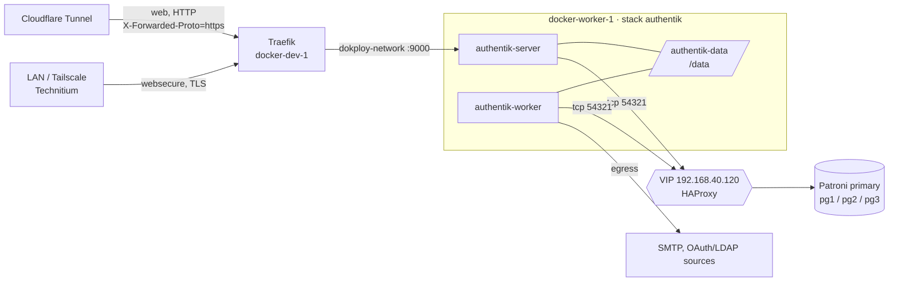

# authentik (SSO / identity provider)

Single sign-on for the homelab apps (OIDC / OAuth2, SAML, LDAP, forward-auth).

| | |
|---|---|
| Status | **Compose written, not deployed yet** |
| Compose | `dokploy/compose-files/projects/homelab/authentik/compose.yml` |
| Env sample | `dokploy/compose-files/projects/homelab/authentik/.env.sample` |
| Dokploy type | Compose, **Docker Swarm** (can't be changed after creation) |
| Node | `docker-worker-1` (server + worker pinned there) |
| Version | `ghcr.io/goauthentik/server:2026.8.5` (`AUTHENTIK_TAG`) |
| Database | **External** Postgres: database `authentik`, role `authentik`, on the [Patroni cluster](patroni-cluster-guide.md) VIP `192.168.40.120:54321` (`PG_HOST` / `PG_PORT`) |
| Domains | `authentik.homelab.capilabs.dev` (public), `authentik.home.capilabs.dev` (local) |
| Data | `/mnt/docker-storage/authentik/{data,certs,custom-templates}` on `docker-worker-1` |
| Secrets | `infisical:/homelab/authentik/secret-key`, `infisical:/homelab/authentik/db-password`, `infisical:/homelab/authentik/bootstrap-password`, `infisical:/homelab/authentik/smtp-password` |

## Layout



- **External database.** authentik recommends running Postgres separately rather than using the one
  in their example stack. This one uses the Patroni cluster, which gives failover and is backed up with the
  other databases. HAProxy on the VIP always routes to the current primary.
- **No Redis.** authentik removed Redis in 2025.10; cache, tasks and websockets are in Postgres.
  It opens about 50% more DB connections than before, so check `max_connections` on the cluster
  (see [step 1](#1-create-the-role-and-database)).
- Server and worker only join `dokploy-network`; that's both Traefik's path in and their way out to
  VLAN 40. They share the `authentik-data` bind volume, so both stay on one node.

## Differences from the upstream compose file

Based on the official [`compose.yml`](https://docs.goauthentik.io/compose.yml) (2026.8.5):

| Upstream | Here | Why |
|---|---|---|
| Bundled `postgresql` service | None, `PG_HOST`/`PG_PORT` point to an external server | authentik recommends a separately run DB. Patroni gives HA and the backups cover it |
| `shm_size: 512mb` | `tmpfs` mount on `/dev/shm`, 512 MiB | `docker stack deploy` ignores `shm_size` |
| Worker mounts `docker.sock`, `user: root` | Neither | No Docker-managed outposts. The embedded outpost (in the server) still handles proxy/forward-auth. Add both back only if you need extra outposts managed by authentik |
| `env_file: .env` | `${VAR}` substitution | Same as the other Swarm stacks (Forgejo) |
| Ports 9000/9443 published | None | Traefik reaches `:9000` over `dokploy-network` |
| `depends_on` | Dropped | Swarm ignores it. authentik retries until the DB answers and the restart policy has no `max_attempts` |

## Deploy

### 1. Create the role and database

Run from any VLAN 40 host with `psql` (e.g. `pg1`). This connects through the VIP so it lands on the
primary. `dbadmin` is the cluster admin from the [Patroni guide](patroni-cluster-guide.md).

```bash
# Generate the app password and store it in Infisical: infisical:/homelab/authentik/db-password
export AUTHENTIK_DB_PASSWORD="$(openssl rand -hex 32)"; echo "$AUTHENTIK_DB_PASSWORD"

psql -h 192.168.40.120 -p 54321 -U dbadmin -d postgres \
  -v ON_ERROR_STOP=1 -v pw="$AUTHENTIK_DB_PASSWORD" <<'SQL'
CREATE ROLE authentik LOGIN PASSWORD :'pw';
CREATE DATABASE authentik OWNER authentik ENCODING 'UTF8' TEMPLATE template0;
REVOKE ALL ON DATABASE authentik FROM PUBLIC;
SQL
```

Owning the database also gives `authentik` the `public` schema on Postgres 15+, so no extra grants
are needed.

Check access from `docker-worker-1` (`192.168.40.11`) as the app user. The guide's `pg_hba` already
allows `192.168.40.0/24`:

```bash
docker run --rm -it postgres:17-alpine \
  psql "postgresql://authentik@192.168.40.120:54321/authentik" -c 'select current_user, inet_server_addr();'
```

Connection headroom:

```bash
psql -h 192.168.40.120 -p 54321 -U dbadmin -d postgres -c 'show max_connections;' \
  -c "select datname, count(*) from pg_stat_activity group by 1 order by 2 desc;"
```

TODO: measure how many connections authentik opens once it's running and raise `max_connections`
in the Patroni config if needed.

### 2. Create the host directories on `docker-worker-1`

The bind driver doesn't create them. authentik runs as UID 1000 (no longer root on the worker), so
it needs to own its directories.

```bash
sudo mkdir -p /mnt/docker-storage/authentik/{data,certs,custom-templates}
sudo chown -R 1000:1000 /mnt/docker-storage/authentik
```

### 3. Generate the secret key

```bash
openssl rand -base64 60 | tr -d '\n'; echo   # -> infisical:/homelab/authentik/secret-key
```

!!! warning
    Never change `AUTHENTIK_SECRET_KEY` after the first start: it signs sessions and tokens.

### 4. Create the Dokploy app

1. Project **homelab** → **Create Service → Compose**, Compose Type **Docker Swarm**.
2. Paste `compose.yml`, and put `.env.sample` (with real values) into the **Environment** tab.
3. Deploy.

### 5. DNS

- Public: `authentik.homelab.capilabs.dev` in Cloudflare, routed through the tunnel to Traefik.
- Local: `authentik.home.capilabs.dev` in Technitium, pointing at Traefik
  (not needed if `home.capilabs.dev` has a wildcard — TODO: confirm).

### 6. First login

Either set `AUTHENTIK_BOOTSTRAP_EMAIL` / `AUTHENTIK_BOOTSTRAP_PASSWORD` before the first deploy
(`akadmin` gets that password), or open the setup flow. **The trailing slash is required:**

```text
https://authentik.home.capilabs.dev/if/flow/initial-setup/
```

Then clear the bootstrap variables in Dokploy.

### 7. Check it

```bash
docker stack ps $(docker stack ls --format '{{.Name}}' | grep authentik) --no-trunc
docker service logs -f $(docker service ls --format '{{.Name}}' | grep authentik-server)
curl -fsS -o /dev/null -w '%{http_code}\n' https://authentik.home.capilabs.dev/-/health/live/
```

On the public name, open **Admin → Applications → Providers → (an OAuth2 provider)** and check the
issuer and redirect URLs start with `https://`. If they show `http://`, the
`authentik-forwarded-https` middleware isn't being applied (see below).

## Traefik

Same dual-router pattern as the other apps, under `deploy.labels`, plus one extra middleware on the
**public** router:

```yaml
- traefik.http.middlewares.authentik-forwarded-https.headers.customrequestheaders.X-Forwarded-Proto=https
- traefik.http.routers.authentik-public.middlewares=authentik-forwarded-https
```

Cloudflare terminates TLS and cloudflared hits Traefik's `web` entrypoint over plain HTTP. Unless
Traefik trusts cloudflared's forwarded headers, it sends `X-Forwarded-Proto: http`, so authentik
would build `http://` redirect and issuer URLs and OAuth logins would fail. The local router
terminates TLS in Traefik, so it already sends `https`. TODO: confirm after the first deploy.

## Backups and upgrades

The database lives on the cluster, so a backup of this stack has two parts: the `authentik`
database and `/mnt/docker-storage/authentik/` (media, certs, templates).

```bash
pg_dump -h 192.168.40.120 -p 54321 -U authentik -d authentik -Fc -f authentik-$(date +%F).dump
sudo tar -czf authentik-files-$(date +%F).tgz -C /mnt/docker-storage authentik   # on docker-worker-1
```

Before an upgrade, read the release notes for every version between the current and the target tag
(TODO: confirm whether authentik lets you skip releases or needs one step at a time). Take both
backups, then bump `AUTHENTIK_TAG`.

TODO: add the `authentik` database to Databasus once it's deployed.
