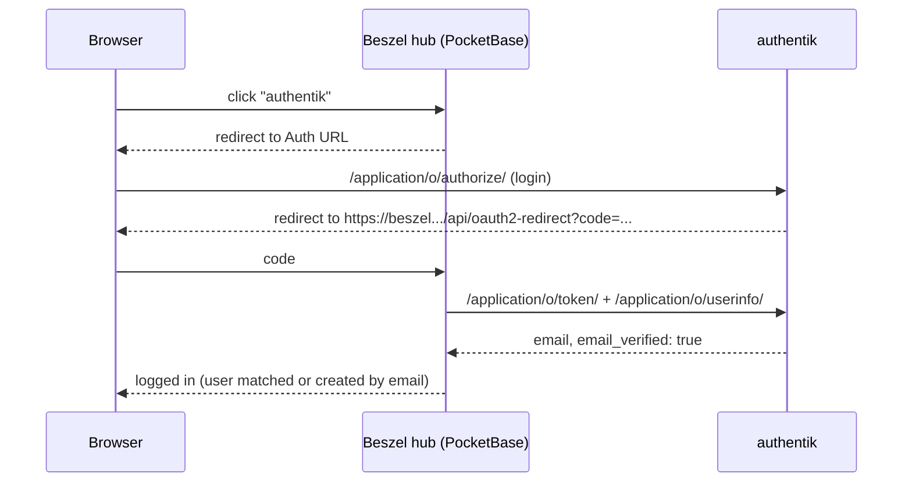

# Beszel (monitoring)

Lightweight server and container monitoring: a hub with the dashboard and one agent per Swarm node.

| | |
|---|---|
| Compose | `dokploy/compose-files/projects/homelab/beszel/compose.yml` |
| Dokploy app | Swarm · `homelab-beszel-eynrop` |
| Version | `henrygd/beszel:0.19.0`, `henrygd/beszel-agent:0.19.0` |
| Hub | `beszel-hub` on `docker-worker-1`, port 8090 on `dokploy-network` |
| Agents | `beszel-agent` (`docker-worker-1`), `beszel-agent-dev1` (`docker-dev-1`), each with its own KEY/TOKEN pair |
| URLs | `https://beszel.homelab.capilabs.dev` (public, tunnel, `APP_URL`), `https://beszel.home.capilabs.dev` (local) |
| Data | `/mnt/docker-storage/beszel/{hub_data,agent_data,agent_data_dev1}` |
| Auth | authentik SSO via OpenID Connect (PocketBase OAuth2), see below |

## Authentication (authentik OIDC)

Beszel signs users in through authentik with PocketBase's OpenID Connect support. It's set up in
the PocketBase admin UI (`/_/`), not with a Beszel setting. Unlike Dozzle, this is real OIDC, not
[forward auth](authentik-forward-auth.md), so the Traefik routers carry no authentik middleware.



Prerequisites:

- Admin access to authentik and to the Beszel hub (PocketBase superuser).
- Beszel reachable at the exact HTTPS URL you register as the redirect.
- Access to the hub's environment (the Dokploy app / `compose.yml`).

authentik here is 2026.8.5, so both version notes below apply: the default email mapping sends
`email_verified: false` (since 2025.10), and redirect URIs have a type (since 2026.5).

### Step 1: email-verified scope mapping in authentik

Beszel only accepts a login when the email scope returns `email_verified: true`. Since authentik
2025.10 the default email scope mapping returns `false`, because an email address alone doesn't
prove the user controls it. Without a custom mapping, OIDC login in Beszel fails.

1. authentik Admin → **Customization → Property Mappings → Create**.
2. Type **Scope Mapping** → **Next**.
3. **Name:** `Beszel email_verified`.
4. **Scope name:** `email`. It must be `email` so it replaces the default email scope.
5. **Expression:** one of the two options below → **Finish**.

**Option A: treat every address as verified.** Only if something else already verifies every
user's email (e.g. accounts are only created by an admin). It asserts every current address is
verified.

```python
return {
    "email": request.user.email,
    "email_verified": True,
}
```

**Option B: read verification from a user attribute.** If addresses can change or be unverified.
Returns a boolean `email_verified` attribute on each user, defaulting to `false`.

```python
return {
    "email": request.user.email,
    "email_verified": request.user.attributes.get("email_verified", False),
}
```

With Option B, set `email_verified: true` in each user's attributes (**Directory → Users → the
user → Attributes**), and clear it whenever their email address changes.

TODO: record which option is in use here.

The mapping is attached to the provider in step 2.

### Step 2: application and provider in authentik

1. authentik Admin → **Applications → Applications** → create a new application.
2. Set the name, group and policy engine mode as needed.
3. Provider type **OAuth2/OpenID Connect**.
4. Save the **Client ID** and **Client Secret**; Beszel needs both. Store the secret in
   Infisical (`infisical:/homelab/beszel/oidc-client-secret` — TODO: confirm the path).
5. Redirect URIs, type **Authorization**, mode **Strict**:
    - `https://beszel.homelab.capilabs.dev/api/oauth2-redirect`
    - `https://beszel.home.capilabs.dev/api/oauth2-redirect`

    The redirect is built from the URL you opened Beszel on, so register every hostname you log
    in from. TODO: confirm both are registered.
6. Select any available signing key.
7. **Advanced protocol settings → Scopes:** add `Beszel email_verified` to Selected Scopes and
   **remove** `authentik default OAuth Mapping: OpenID 'email' scope`. If both stay selected, the
   default one can still send `false`.
8. Optionally add bindings to control who can see and use the application, then submit.

On authentik versions before 2026.5 every redirect URI is treated as Authorization type; there,
add only the Authorization URLs and skip any post-logout URI.

### Step 3: OpenID Connect provider in Beszel

1. Open `https://beszel.home.capilabs.dev/_/#/settings`, turn **off** the option that hides
   collection create and edit controls, and save.
2. Open the **users** collection: `https://beszel.home.capilabs.dev/_/#/collections?collection=pb_users_auth`.
3. Gear icon → **Options** tab → enable **OAuth2**.
4. **Add provider** → **OpenID Connect**.
5. Enter the values below → **Set provider config** → save.
6. Back on the settings page, turn the hide-controls option back **on** and save.

| Field | Value |
| --- | --- |
| Client ID | From authentik |
| Client secret | From authentik (`infisical:/homelab/beszel/oidc-client-secret`) |
| Display name | `authentik` |
| Auth URL | `https://authentik.homelab.capilabs.dev/application/o/authorize/` |
| Token URL | `https://authentik.homelab.capilabs.dev/application/o/token/` |
| Fetch user info from | User info URL |
| User info URL | `https://authentik.homelab.capilabs.dev/application/o/userinfo/` |

Which authentik hostname to use:

- **Auth URL** is opened by the browser. Beszel is published on the internet, so use the public
  host `authentik.homelab.capilabs.dev` or a login from outside the LAN can't reach authentik.
- **Token URL** and **User info URL** are called by the hub container on `docker-worker-1`. The
  local host `authentik.home.capilabs.dev` only works if that node resolves through Technitium;
  public DNS answers with Cloudflare addresses that have no certificate for `*.home` (same problem
  as [Proxmox VE login](authentik.md#proxmox-ve-login-openid-connect-realm)). The public host
  always works, at the cost of a round trip through Cloudflare.

TODO: record which hostnames are actually configured, and check from the hub:

```bash
# on docker-worker-1
docker exec $(docker ps -qf name=beszel-hub) \
  wget -qO- https://authentik.home.capilabs.dev/application/o/<application-slug>/.well-known/openid-configuration | head -c 200; echo
```

### Step 4: how users get created

Beszel doesn't create users by default. Either:

- create each user in the **users** collection with the same email as their authentik account, or
- set `USER_CREATION=true` on the hub so accounts are created on first OIDC login.

**Here:** `USER_CREATION: "true"` is set in `compose.yml`.

To allow only OIDC login, set `DISABLE_PASSWORD_AUTH=true` on the hub. Set it through the
environment variable, not in PocketBase: the env value overwrites the PocketBase setting on every
restart. Turn it on only after OIDC login is confirmed to work.

```yaml
    environment:
      USER_CREATION: "true"
      DISABLE_PASSWORD_AUTH: "true"
```

**Here:** `DISABLE_PASSWORD_AUTH` isn't set yet, so password login still works.

TODO: set `DISABLE_PASSWORD_AUTH: "true"` once OIDC login is confirmed. The PocketBase superuser
login at `/_/` is separate and keeps working as the break-glass account.

### Step 5: verify

Open Beszel and click **authentik**. You should be sent to authentik and back to Beszel after
signing in.

If login fails, check these first:

- The redirect URI in authentik matches `https://<beszel host>/api/oauth2-redirect` exactly,
  including the scheme, for the host you opened Beszel on. Behind Traefik/Cloudflare, use the
  external HTTPS URL.
- A matching user exists in the **users** collection, or `USER_CREATION=true` is set.
- The provider uses the `Beszel email_verified` scope mapping and not the default email mapping.
- The hub can reach the Token and User info URLs (see step 3).

TODO: confirm an OIDC login works on both the public and the local URL.

## Sources

- [Beszel OAuth / OIDC guide](https://beszel.dev/guide/oauth)
- [authentik integration guide for Beszel](https://integrations.goauthentik.io/monitoring/beszel/)
- [authentik: verify email address (scope mapping)](https://docs.goauthentik.io/add-secure-apps/providers/oauth2/verify-email-address/)
