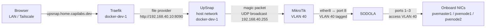

# UpSnap (Wake-on-LAN)

Web dashboard to wake, ping and (optionally) shut down devices. Used to wake the Proxmox nodes from
power-off through their onboard NICs, see [Wake-on-LAN](../network/usb-2.5g-adapters.md#wake-on-lan-onboard-nics).

| | |
|---|---|
| Compose | `dokploy/compose-files/projects/homelab/upsnap/compose.yml` (+ `.env.sample`) |
| Dokploy app | `Upsnap` · Compose Type **Docker Compose** (not Swarm) |
| Node | `docker-dev-1` |
| Image | `ghcr.io/seriousm4x/upsnap:5` (major-version tag, kept as is) |
| Network | `network_mode: host`, listens on `192.168.40.10:8090` only (`UPSNAP_LISTEN`) |
| URL | `https://upsnap.home.capilabs.dev` (local + Tailscale only, no public router) |
| Traefik | File provider: `dokploy/traefik/dynamic/upsnap.yml` → `/etc/dokploy/traefik/dynamic/upsnap.yml` |
| Data | bind `/mnt/docker-storage/upsnap/data` → `/app/pb_data` (PocketBase) |
| Auth | UpSnap's own login. The admin account is created on the first visit |

Set up and confirmed waking a node on 2026-11-27.

## How it fits together



## Why it's deployed this way

- **Host networking, so plain Docker Compose.** Magic packets are L2 broadcasts, and the ping and
  network scan use raw ICMP and nmap, so UpSnap needs the host's network stack. Swarm ignores
  `network_mode: host` next to `deploy:`, so this follows the "needs host networking" branch in
  [Dokploy / Swarm](../platforms/dokploy-swarm.md#choosing-how-to-deploy-something).
- **Traefik route in a file, not labels.** A host-network container has no IP on
  `dokploy-network`. For such a container Traefik's Docker provider guesses `host.docker.internal`
  or `127.0.0.1`, and inside the `dokploy-traefik` container neither is the host. The file route
  points at the host address directly, like `technitium-lxc.yml`.
- **Bound to `192.168.40.10` only,** not `0.0.0.0`, so it isn't served on every interface of
  `docker-dev-1`. The address in `UPSNAP_LISTEN` (`.env`) and the URL in `upsnap.yml` must match.
- **The onboard NICs are on VLAN 40, UpSnap's own VLAN.** A broadcast doesn't cross a router, so a
  magic packet sent from VLAN 40 never reached the NICs while they were on VLAN 1. Moving SODOLA
  ports 1–3 to VLAN 40 puts UpSnap and the NICs on the same L2 network. See
  [Wake-on-LAN](../network/usb-2.5g-adapters.md#wake-on-lan-onboard-nics) and
  [gotchas](../gotchas.md#proxmox-storage-network).

## Deploy

```bash
# on docker-dev-1
sudo mkdir -p /mnt/docker-storage/upsnap/data
ss -ltnp | grep 8090                                  # must be free
sudo cp upsnap.yml /etc/dokploy/traefik/dynamic/      # from dokploy/traefik/dynamic/
```

1. In Dokploy, create a Compose app with Compose Type **Docker Compose** and point it at
   `upsnap/compose.yml`. Copy `.env.sample` into the app's environment.
2. Add a Technitium record `upsnap.home.capilabs.dev` → Traefik (`192.168.40.10`). It exists
   (confirmed 2026-11-27).
3. Open `https://upsnap.home.capilabs.dev` and create the admin account.

`LOCAL_DOMAIN` in `.env.sample` isn't read by the compose file: the host name lives in
`upsnap.yml`. It's kept on purpose, as a record of the app's domain. Change both together.

## Devices

**Network scan doesn't work for VLAN 1.** The scan needs each device's MAC, and nmap only learns
MACs (ARP) on UpSnap's own segment. Scanning `192.168.1.0/24` from VLAN 40 lists hosts as up but
with no MAC, so UpSnap shows nothing. Scanning `192.168.40.0/24` works. The three Proxmox nodes were added by
hand (**New device → manual**), 2026-11-27:

| Device | IP (ping / status) | MAC (onboard NIC) | Netmask |
|---|---|---|---|
| `pvemaster1` | `192.168.40.5` | `7c:57:58:5d:a2:e4` | `255.255.255.0` |
| `pvenode1` | `192.168.40.6` | `20:88:10:97:b9:44` | `255.255.255.0` |
| `pvenode2` | `192.168.40.7` | `30:13:8b:81:e4:a8` | `255.255.255.0` |

- The **IP** is the node's VLAN 40 host address (`vmbr1.40`). UpSnap pings it for status, and
  works out the wake address from IP + netmask, so it must be on VLAN 40 to send to
  `192.168.40.255`.
- The **MAC** is the onboard NIC's (the one with WoL on), not the USB adapter's. Don't copy the
  nodes' MACs from the MikroTik ARP table: those are the USB adapters.
- **`pvemaster1` is listed for its status only.** It hosts `docker-dev-1`, so UpSnap is down
  whenever `pvemaster1` is and can't wake it. Wake it from the MikroTik:

```bash
# on the MikroTik
/tool wol interface=vlan-40 mac=7c:57:58:5d:a2:e4
```

To check a scan by hand (no `MAC Address:` lines = the device is on another VLAN):

```bash
# on docker-dev-1
docker exec upsnap nmap -sn 192.168.40.0/24 --host-timeout 500ms
```

## Test a wake

With the node still running, capture on its onboard NIC and press wake in UpSnap:

```bash
# on pvenode2 (nic0) or pvenode1 (nic0)
tcpdump -ni nic0 -e udp port 9
```

A frame to `ff:ff:ff:ff:ff:ff` means the path works. Then power the node off and wake it for real.
A wake from power-off worked on each node (owner, 2026-11-27).

## Troubleshooting

| Symptom | Cause | Fix |
|---|---|---|
| Scan finds nothing | Scan range is on another VLAN, no MACs | Add devices manually, see [Devices](#devices) |
| MikroTik `/tool wol` wakes the node, UpSnap doesn't | Magic packet is crossing a router (device IP on another VLAN) | Use the node's VLAN 40 IP in UpSnap; check SODOLA ports 1–3 are access VLAN 40 |
| 404 / bad gateway on `upsnap.home…` | `upsnap.yml` missing on the server, or `UPSNAP_LISTEN` and the file's URL differ | Re-copy the file, compare the two addresses |
